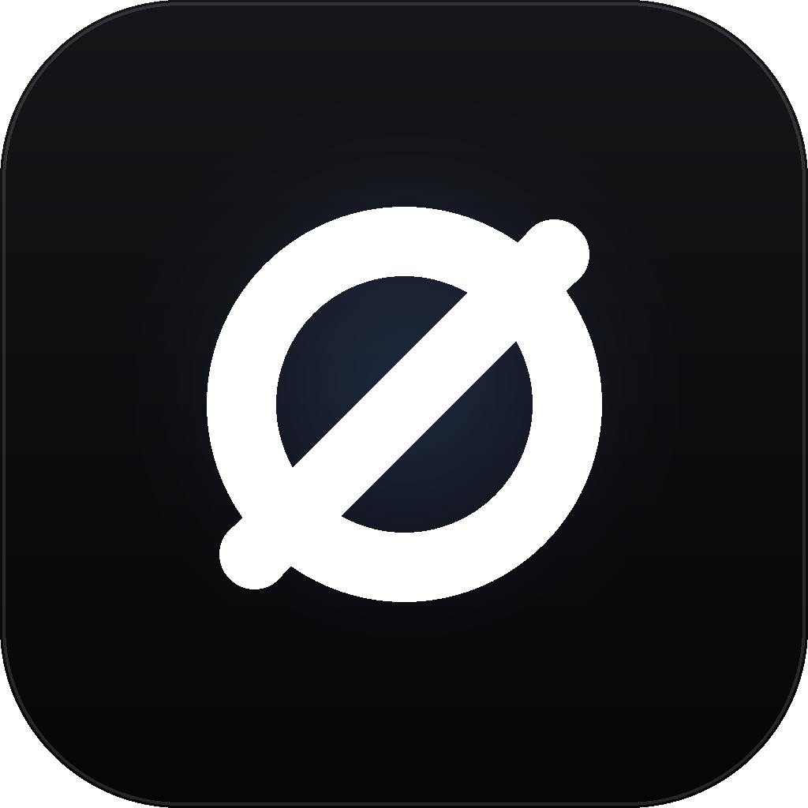
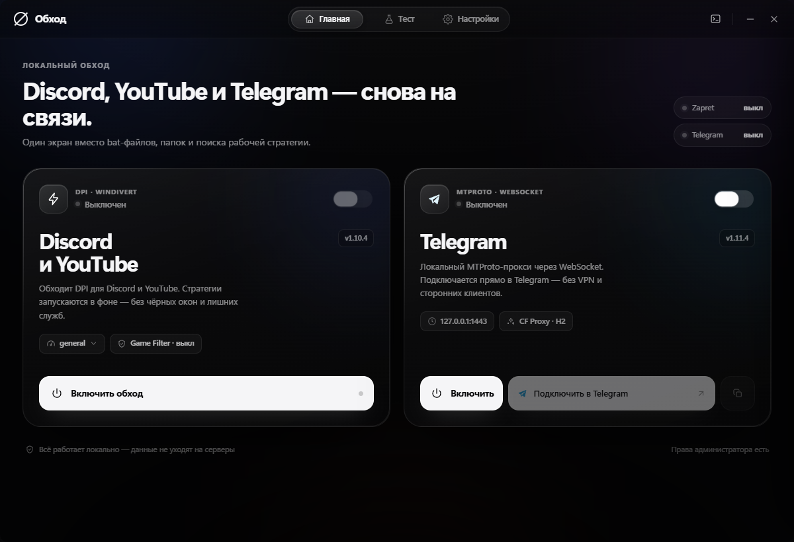
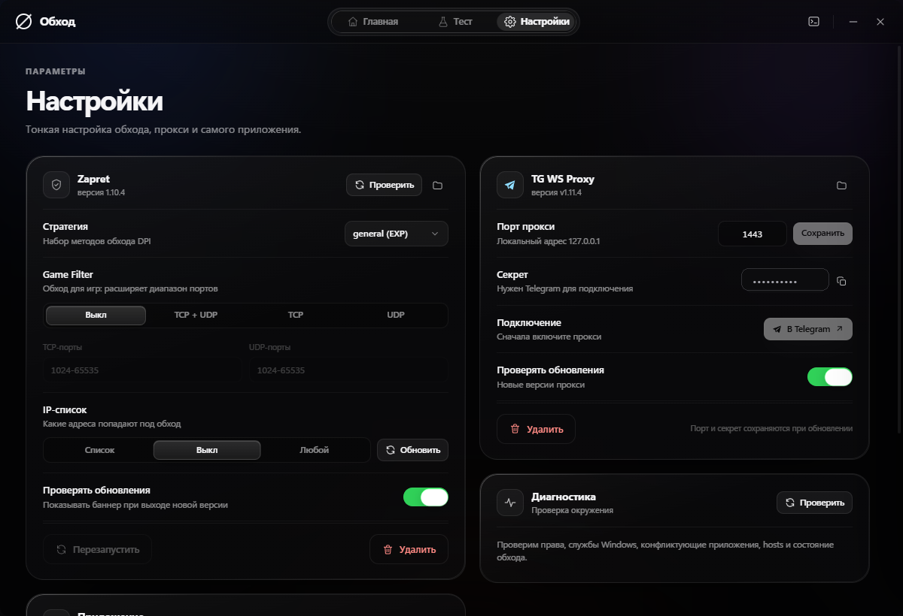
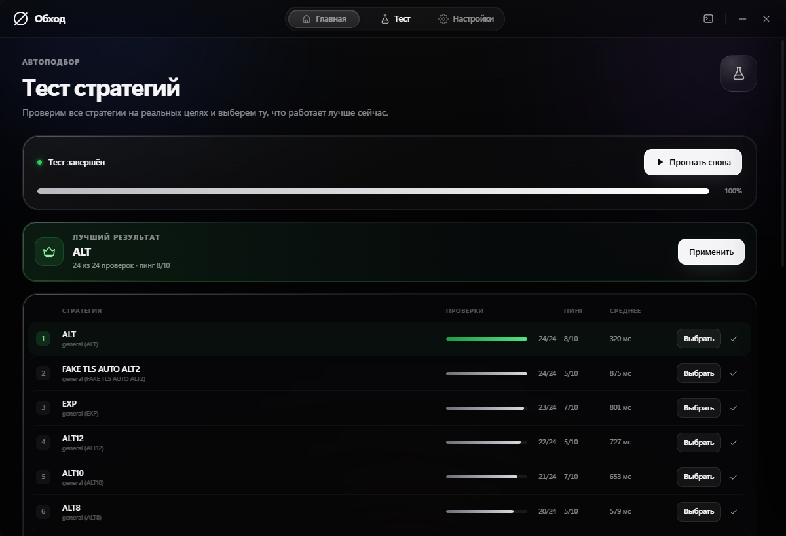

<p align="center">
  
</p>

<h1 align="center">Обход</h1>

<p align="center">
  Один тёмный экран для Discord, YouTube и Telegram.<br />
  Zapret и TG WS Proxy — установка, запуск, настройки и автообновление в одном приложении.
</p>

<p align="center">
  <a href="https://github.com/aenesmeiyo/obhod/releases/latest">
    
  </a>
  
  
  
</p>

<p align="center">
  
</p>

---

## Что это

**«Обход»** — минималистичное Windows-приложение, которое собирает в одном месте два
инструмента обхода блокировок:

- **[zapret-discord-youtube](https://github.com/Flowseal/zapret-discord-youtube)** — обход DPI для
  Discord, YouTube и других сервисов.
- **[tg-ws-proxy](https://github.com/Flowseal/tg-ws-proxy)** — MTProto-прокси для Telegram через
  WebSocket.

Приложение не заменяет их и не переписывает: оно скачивает **официальные релизы** с GitHub,
запускает их в фоне, хранит настройки и помогает выбрать рабочую стратегию. Больше не нужно
распаковывать архивы, искать `service.bat`, держать чёрные консоли и вручную проверять конфиги.

## Возможности

| | |
| --- | --- |
| **Два тумблера** | Zapret и Telegram-прокси с честным статусом процессов и индикацией в трее. |
| **Фоновый запуск** | Стратегии `.bat` разбираются на аргументы, `winws.exe` стартует скрыто. Никаких окон `cmd`. |
| **Установка в один клик** | Оба компонента скачиваются из официальных релизов Flowseal и распаковываются в данные приложения. |
| **Автообновления** | Тихая проверка GitHub при запуске. Если есть новая версия — аккуратный баннер. Старые файлы заменяются, настройки сохраняются. |
| **Game Filter** | Как в `service.bat`: выкл / TCP / UDP / TCP+UDP и свои диапазоны портов. |
| **IPSet** | Режимы «Список», «Выкл», «Любой» и обновление списка IP с GitHub. |
| **Тест стратегий** | Проверяет заморозку TCP 16–20 на Discord, YouTube и публичных хостах, сравнивает с фоном без обхода и строит рейтинг. |
| **Подключение Telegram** | Кнопка рядом с включением прокси открывает `tg://proxy` с актуальным портом и секретом. |
| **Диагностика** | Права, Base Filtering Engine, TCP timestamps, WinDivert, системный прокси, конфликтующие приложения, `hosts`. |
| **Трей и автозапуск** | Закрытие прячет окно в трей; автозапуск через Планировщик задач — без UAC при каждом входе. |
| **Liquid Glass UI** | Чёрная тема, стеклянные панели, пружинные переключатели [glisse](https://github.com/0kzh/glisse), плавные анимации в духе Windows 11. |

## Скриншоты

<details>
<summary><b>Настройки</b> — Game Filter, IPSet, порт и секрет Telegram</summary>
<br />

</details>

<details>
<summary><b>Тест стратегий</b> — рейтинг, проверки и лучший конфиг</summary>
<br />

</details>

## Скачать

Готовый установщик лежит в **[GitHub Releases](https://github.com/aenesmeiyo/obhod/releases/latest)**:

**[⬇ Obhod-Setup-1.0.3.exe](https://github.com/aenesmeiyo/obhod/releases/latest)**

Папка [`releases/`](releases/) в репозитории содержит заметки к релизам и контрольные суммы.
Сам `.exe` намеренно не коммитится в git: установщик весит ~116 МБ, а GitHub не принимает файлы
больше 100 МБ. Поэтому бинарник прикреплён к GitHub Release — это стандартный способ раздавать
сборки, и его можно скачать обычной ссылкой.

### Установка

1. Скачайте `Obhod-Setup-*.exe` из раздела **Releases**.
2. Запустите установщик. Он ставится **сразу для всех пользователей** в `Program Files`, без
   вопросов о папке и режиме установки, и создаёт ярлыки «Обход» на рабочем столе и в Пуске.
   Windows один раз спросит подтверждение UAC на установку.
3. После установки «Обход» запускается **без запроса прав администратора**. Права нужны только
   самому Zapret: нажмите «Перезапустить» в баннере, когда захотите включить обход DPI. Прокси
   Telegram работает и без прав администратора.
4. На главном экране нажмите **«Скачать Zapret»** и **«Скачать TG WS Proxy»**, затем включите нужное
   тумблером.

> **SmartScreen.** Установщик не подписан коммерческим сертификатом, поэтому Windows может показать
> «Неизвестный издатель». Выберите «Подробнее» → «Выполнить в любом случае». Это нормально для
> open-source сборки без платной подписи.

## Как пользоваться

### Zapret

1. Скачайте Zapret на главном экране.
2. Включите тумблер в шапке карточки Zapret.
3. Если что-то не работает — откройте **Тест стратегий**: приложение запустит все конфиги и
   покажет, какой лучше подходит вашей сети.
4. Стратегию можно выбрать вручную в настройках или в чипе на карточке.

Обход продолжает работать при закрытии окна — приложение сворачивается в трей. Полностью выйти
можно через меню трея → **Выход**.

### Telegram

1. Включите **TG WS Proxy**.
2. Нажмите **«Подключить в Telegram»** — откроется Telegram с готовой ссылкой.
3. Если Telegram не открылся, нажмите кнопку копирования: вставьте ссылку в «Избранное» и нажмите
   на неё.

Прокси слушает `127.0.0.1:1443`; порт меняется в настройках. Секрет генерируется один раз и
сохраняется при обновлениях.

> У официального `TgWsProxy_windows.exe` есть собственный значок в трее — приложение запускает его
> как фоновый процесс и не показывает его окно.

## Тест стратегий

Тест воспроизводит реальную блокировку **TCP 16–20**: провайдер пропускает рукопожатие и первые
~16–20 КБ, а затем «замораживает» соединение. Поэтому обычный HEAD-запрос выглядит успешным, хотя
видео уже не грузится. Приложение отправляет на каждый хост POST с 64 КБ и ждёт ответ:

- **Discord** (`discord.com`, `gateway.discord.gg`, `cdn.discordapp.com`) и **YouTube**
  (`www.youtube.com`, `i.ytimg.com`, `redirector.googlevideo.com`) — по TLS 1.3 и TLS 1.2;
- контрольный `www.google.com` — чтобы заметить стратегию, которая ломает здоровый трафик;
- публичные хосты из [dpi-checkers](https://github.com/hyperion-cs/dpi-checkers) — по одному на
  провайдера (Hetzner, OVH, DigitalOcean, Cloudflare, Akamai, Fastly и другие), TLS 1.3.

Перед стратегиями снимается **базовая линия без обхода**. Для каждой стратегии считается, сколько
целей она **исправила** (было заблокировано — стало ок), сколько **сохранила** и сколько
**сломала**. Лучшая — не та, где просто больше «зелёных», а та, что реально снимает блокировки и
ничего не ломает. Лидер после отбора проверяется ещё раз.

Стратегии можно гонять параллельно: приложение поднимает до трёх `winws.exe` с разными
стратегиями, и каждый видит только свои соединения — полный фильтр `--wf-raw` по исходным портам и
IP проверяемых хостов. Официально zapret разрешает несколько процессов, если фильтры не
пересекаются ([docs/windows.md](https://github.com/bol-van/zapret/blob/master/docs/windows.md)).
Если полоса не запускается, стратегия автоматически проверяется отдельно. Режим отключается в
настройках.

На время теста обход останавливается, `ipset-all.txt` переключается на «любой» и возвращается
обратно, даже если тест прерван. HTTP/HEAD-проверки и ping убраны: HEAD не доходит до порога
16–20 КБ и показывает «ок» там, где видео уже заблокировано.

## Где лежат данные

| Что | Путь |
| --- | --- |
| Данные приложения | `%LOCALAPPDATA%\Obhod` |
| Zapret | `%LOCALAPPDATA%\Obhod\zapret` |
| TG WS Proxy | `%LOCALAPPDATA%\Obhod\tgws` |
| Лог приложения | `%LOCALAPPDATA%\Obhod\logs\app.log` |
| Лог Zapret | `%LOCALAPPDATA%\Obhod\logs\winws.log` |
| Лог прокси | `%LOCALAPPDATA%\Obhod\tgws\TgWsProxy_data\proxy.log` |

Приложение устанавливается для всех пользователей, но данные и компоненты у каждого
пользователя свои — они лежат в его `%LOCALAPPDATA%`. Все данные остаются локально. Приложение не
отправляет телеметрию. В сеть уходят только запросы к
GitHub (релизы и список IP), проверки целей во время теста и сам Telegram-трафик через локальный
прокси.

## Сборка из исходников

Нужны **Node.js 22.12+** и **pnpm**, Windows 10/11 x64.

```powershell
pnpm install
pnpm dev        # разработка
pnpm typecheck  # проверка типов
pnpm dist       # установщик в release/
```

`pnpm dev` запускает приложение без прав администратора: интерфейс и установка компонентов
работают, а Zapret включить нельзя. Используйте кнопку **«Перезапустить»** в баннере либо соберите
установщик.

### Стек

- Electron 45 + electron-vite + React 19 + TypeScript
- `adm-zip` — распаковка релизов
- `glisse` — Liquid Glass-переключатели и пружинные анимации
- `electron-builder` + NSIS — установщик
- Установщик: NSIS one-click, per-machine (для всех пользователей)
- Манифест приложения: `asInvoker`; повышение прав — только по кнопке для Zapret

### Структура

```
src/main/              Electron main: менеджеры, IPC, загрузки, обновления
  zapret/              парсер стратегий, запуск winws, настройки, тесты
  tgws/                установка и запуск TG WS Proxy
src/preload/           typed contextBridge API
src/renderer/          React-интерфейс и стили
src/shared/            общие типы IPC
.github/workflows/     сборка установщика и релизов
releases/              заметки к релизам и контрольные суммы
docs/                  скриншоты
```

## Благодарности

Огромное спасибо **[Flowseal](https://github.com/Flowseal)** за
[zapret-discord-youtube](https://github.com/Flowseal/zapret-discord-youtube) и
[tg-ws-proxy](https://github.com/Flowseal/tg-ws-proxy). Без этих проектов «Обход» был бы просто
красивой пустой оболочкой. Если вы пользуетесь приложением — зайдите и поставьте звёзды этим
репозиториям, это лучшая поддержка автора.

Отдельное спасибо:

- [bol-van](https://github.com/bol-van) — за основу zapret;
- [Kelvin Zhang](https://github.com/0kzh) — за [glisse](https://github.com/0kzh/glisse) и
  Liquid Glass для веба;
- авторам Electron, React, Vite и других open-source библиотек.

Подробности и лицензии — в [THIRD_PARTY_NOTICES.md](THIRD_PARTY_NOTICES.md).

## Дисклеймер

«Обход» — независимый неофициальный проект, не связанный с Flowseal, Telegram или Discord.
Приложение управляет сторонними утилитами и требует прав администратора. Используйте его в
соответствии с законодательством вашей страны и правилами сервисов. Авторы не несут
ответственности за возможный вред, блокировки или потерю данных.

## English

**Obhod** is a minimalist Windows app that installs, runs and updates
[zapret-discord-youtube](https://github.com/Flowseal/zapret-discord-youtube) and
[tg-ws-proxy](https://github.com/Flowseal/tg-ws-proxy) from their official GitHub releases.

- One dark Liquid Glass UI with two on/off controls.
- Hidden background launch of all zapret strategies, game filter and IPSet settings.
- Automatic update checks with a quiet banner.
- Built-in strategy benchmark for Discord, YouTube and Google.
- One-click Telegram proxy connection.
- No telemetry; everything runs locally.

Download: **[Releases](https://github.com/aenesmeiyo/obhod/releases/latest)**. The one-click installer
installs for all users; the app itself starts without UAC, and only Zapret asks for administrator
rights because WinDivert does. The installer is unsigned, so SmartScreen may warn you.

Build: `pnpm install && pnpm dist`. Contributions and bug reports are welcome.
